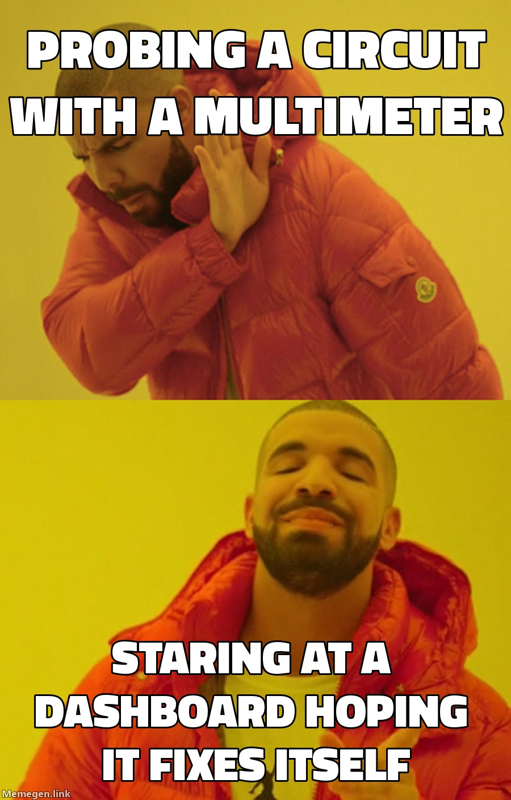

Hello everyone! This is the first post in a small series about my co-op term. I'm an engineering student who spent most of my time thinking about circuits, signals and drones, so when my co-op turned out to be a data role, it felt like a full 180 (╯°□°)╯︵ ┻━┻

## The "180" moment

My picture of "engineering work" was hardware. A board on the desk, a multimeter in my hand, something that either works or lets out the magic smoke. Data work looked like the exact opposite: no soldering, no firmware, just dashboards and a lot of tables.

So day one felt a bit like being dropped into a different country. A lot of the vocabulary was new, the tools were new, and even the definition of "done" was different. A circuit works or it doesn't. A report can look perfectly fine and still be quietly wrong. Rude.

## What actually carried over

Here's the funny part. The 180 turned out to be closer to 90 degrees (¬‿¬). A lot of what I learned in class kept showing up:

- **Debugging is debugging.** A circuit that doesn't work and a report that shows the wrong number are the same problem. Isolate the stage, check the input, check the output, repeat. (See the meme at the top. I'm not even sorry.)
- **Signal and noise.** Raw data is noisy, and the job is to clean it before anyone makes a decision from it. Sounds familiar if you've ever stared at an oscilloscope.
- **Block diagrams.** Source, transform, output. I've drawn that picture a hundred times for circuits, and data pipelines are the exact same shape.
- **Being okay with not knowing.** Engineering school mostly trains you to look at something unfamiliar and start poking at it until it makes sense. Or until it lets out the magic smoke.

## What I had to learn from scratch

The tools (Power BI mostly), the vocabulary, and the habit of asking "who actually uses this?" before building anything. In class the audience for every problem is the professor. At work it's a real person who will be (politely) annoyed if the number is wrong.

## What's coming in this series

I'm going to write about a few things I ran into during the term:

1. Day one (you're here)
2. [The dashboard nobody owned](/my-blog-medium/coop-stalled-dashboard/)
3. [Refactoring a big Power BI dataset](/my-blog-medium/coop-powerbi-refactor/)
4. [Training the next co-ops](/my-blog-medium/coop-training-coops/)
5. [What I'd tell my past self](/my-blog-medium/coop-looking-ahead/)

Thank you for reading. If you're an engineering student staring at a role that looks nothing like what you expected, I hope this helps a little. See you in the next one! (づ｡◕‿‿◕｡)づ
