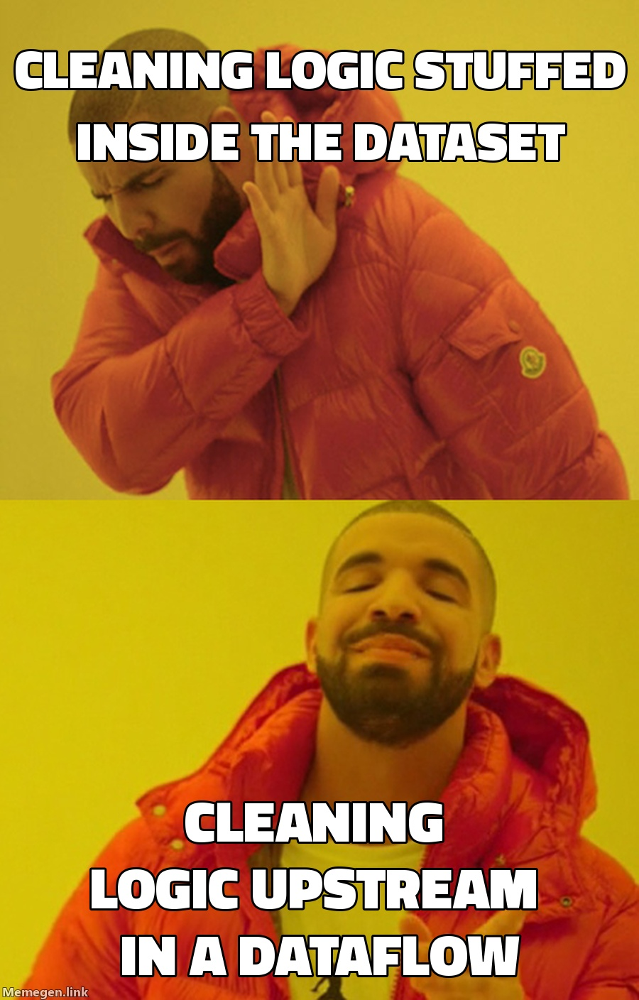

Welcome back! Part 3 of my co-op diary is the nerdiest one so far. It's about a Power BI dataset with over 200 queries, and what happened when I started untangling it. Buckle up (☞ﾟヮﾟ)☞

## What a 200+ query dataset looks like

Nobody sets out to build a monster. It starts with five queries. Then someone needs one more column, then another source, then a quick fix on top of a quick fix. A couple of years later you open the dataset and there are over 200 queries, and the cleaning, the joins and the business logic are all mixed together in one place.

If you're coming from software, think of one giant file where everything lives. It works, until you have to change anything. (See the meme at the top. Buzz gets it.)

## The idea: move logic upstream

The rule I kept coming back to is simple: **do the work as far upstream as you can.**

- The dataset should do what only a dataset can do: relationships and measures.
- The messy cleaning and joining belong in **dataflows**, one step earlier, where they can be reused instead of copy-pasted into every dataset.

It's the same instinct as breaking a big circuit into blocks. Each block does one job, and you can test it on its own.

## How I approached it

I didn't start by rewriting anything. I started by reading.

1. **Take inventory.** List every query and group them by what they do. Raw sources, cleaning steps, helper tables, and a surprising number that nothing used anymore (¬‿¬)
2. **Pick one group and move it.** Cleaning logic that several things depend on goes into a dataflow first.
3. **Point the dataset at the dataflow.** Same shape of data coming out, new place it comes from.
4. **Check the numbers match.** Row counts, totals, a few spot checks against the old version. If the numbers change, I haven't refactored anything, I've changed the report.
5. **Delete what's dead.** Only after the numbers match, and only things I could prove nothing depended on.

Then repeat. Small steps, verify every time.

## What I'd tell anyone starting this

- **Don't do it in one go.** The refactor you can verify piece by piece is the only one you can trust.
- **Names matter.** A query called `Table1 (2)` is a trap for the next person. Name things for what they are.
- **Write down what lives where.** Future-you (or the next co-op) will thank you. I'll get to that in the next post.

Thanks for reading! [Part 4](/my-blog-medium/coop-training-coops/) is about training the next co-ops. (≧▽≦)
