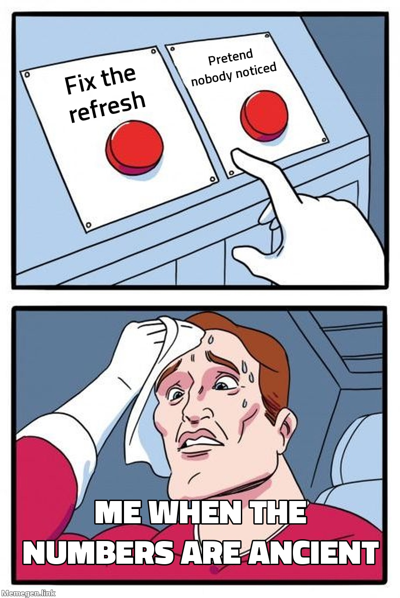

Hello again! This is part 2 of my co-op diary. Today's story is about a dashboard that everyone looked at and nobody owned (╥﹏╥)

## The problem with "it's always been there"

You probably know this one. There's a report that gets opened every week. Nobody remembers who built it, and the person who did has moved on. It just exists, like a vending machine in the hallway.

Then one day I noticed the numbers in it hadn't moved. The refresh had stalled. And here's the scary part: nobody had noticed.

> A dashboard that errors out gets fixed quickly. A dashboard that quietly shows old numbers can sit there looking perfectly healthy.

Stale is worse than broken, because broken is loud. Stale is just vibing.

## How I tracked it down

The exact culprit matters less than the process, and the process is basically debugging a circuit:

1. **Find the last time it worked.** The refresh history tells you when it last succeeded. Everything interesting happened right after that.
2. **Read the actual error.** Not the summary, the full message. It's easy to skip it because it looks long and ugly. Don't.
3. **Work upstream.** Check the dashboard, then the dataset, then whatever feeds it. Same as probing a circuit stage by stage until you find where the signal dies.
4. **Fix it, run it, and verify.** A green checkmark isn't enough. I compared the refreshed numbers against the source to make sure they agreed.

At some point there's a moment where you have two options, and I'll let the meme explain how that felt:

(I fixed it. Obviously. Please don't tell the meme.)

## The part that mattered more than the fix

Getting the refresh running again took a bit of detective work. Making sure it never silently stalls again was the real job:

- **Every dashboard needs an owner.** A name, not a team. If nobody owns it, nobody notices when it breaks.
- **Failure alerts should go to a person.** An alert nobody reads is just a log file.
- **Show "last refreshed" on the report.** If a number is old, the reader should be able to see that without asking.

I'm a perfectionist, so I wanted to do more. But I've learned that a small fix plus an owner beats a perfect fix nobody maintains.

Next up, [part 3](/my-blog-medium/coop-powerbi-refactor/): the big dataset with over 200 queries. Thanks for reading! ٩(◕‿◕)۶
